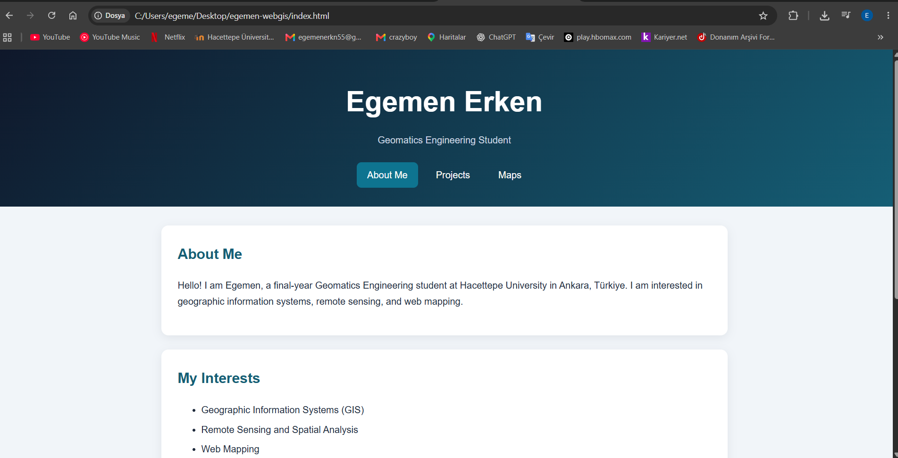

# 🌍 Egemen Erken | WebGIS Portfolio

Welcome to my personal portfolio!  
I am a final-year Geomatics Engineering student at Hacettepe University
in Ankara, Türkiye, interested in GIS, remote sensing, and web mapping.

🎓 **Course:** GMT458 — Web GIS  
👤 **Student:** Egemen Erken  
🆔 **Student ID:** 21967483

## 🚀 Explore the Website

### 🔗 [Visit My WebGIS Portfolio](https://nekrege.github.io/egemen-webgis/)

| Page | What You Will Find |
| --- | --- |
| 👋 [About Me](https://nekrege.github.io/egemen-webgis/) | My background, interests, and introduction |
| 📂 [Projects](https://nekrege.github.io/egemen-webgis/projects.html) | Academic projects, tools, and a gallery with project images |
| 🗺️ [Maps](https://nekrege.github.io/egemen-webgis/maps.html) | Interactive Leaflet and OpenLayers maps of Ankara |

## ✨ Website Features

- 🎨 Navy, teal, and gold design with CSS animation
- 📱 Responsive layout for different screen sizes
- 🖼️ Project information presented in a table with images
- 🗺️ Two interactive maps built with Leaflet and OpenLayers
- 📍 Location markers visible at zoom level **12 and above**
- 💬 Leaflet popups and OpenLayers location descriptions
- 🌐 World repetition disabled in both maps
- 🔄 Reset buttons that restore the initial map view
- ♿ Keyboard focus styles and reduced-motion support

## 🛠️ Technologies

| Technology | Purpose |
| --- | --- |
| HTML5 | Page structure and content |
| CSS3 | Styling, responsive layout, and animation |
| JavaScript | Map interactions and controls |
| Leaflet 1.9.4 | Interactive map with location popups |
| OpenLayers 10.6.1 | Interactive map with vector markers |
| OpenStreetMap | Basemap tiles |
| Git & GitHub | Version control and repository hosting |
| GitHub Pages | Website publishing |

## 📂 Featured Projects

### ⚡ EV Charging & Micromobility Site Selection

GIS-based suitability analysis for EV charging stations and
micromobility parking areas in Çankaya, Ankara, using AHP and
weighted overlay.

### 🌲 LiDAR Surface Modelling

Generation and analysis of terrain, surface, and canopy height
models from LiDAR data.

### 🌐 Personal WebGIS Portfolio

A three-page website combining academic project information
with interactive web maps.

## 🖼️ Website Preview

See the **Projects** page for additional project visuals,
including the EV charging suitability analysis.

## 🧭 Using the Maps

1. Open the **Maps** page.
2. Zoom in to level **12 or higher** to display location markers.
3. Click a marker to view information about the location.
4. Select **Reset View** to return to the initial map view.

Both maps show selected locations in Ankara.
Marker coordinates are approximate and are provided for demonstration.

## 💻 Run Locally

1. Download or clone this repository.
2. Open the project folder in Visual Studio Code.
3. Install the **Live Server** extension.
4. Right-click `index.html` and select **Open with Live Server**.

An internet connection is required to load the mapping libraries
and OpenStreetMap tiles.

## 🤖 AI Assistance & Learning

I used ChatGPT to help develop and troubleshoot this website.
Through this process, I learned how to:

- Style pages with CSS, animations, and responsive layouts.
- Display project information and images in HTML tables.
- Add Leaflet maps, markers, and popups.
- Convert longitude and latitude to map coordinates in OpenLayers.
- Display information when an OpenLayers feature is selected.
- Disable world repetition and add map reset controls.

  

**Estimated total time using AI assistance:** [45 minute]

## 📚 Credits

- Map data: © OpenStreetMap contributors
- Mapping libraries: Leaflet and OpenLayers
- Website content and development: Egemen Erken